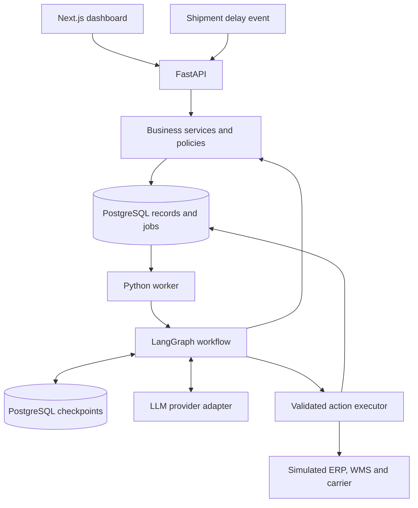

# OpsFlow AI — Architecture

## Goal

Detect delayed inbound shipments, calculate production shortages,
propose recovery actions, obtain human approval, and verify execution.

## MVP Scope

- One manufacturer with a Munich plant and Berlin warehouse.
- Simulated ERP, WMS, and carrier integrations.
- Recovery options: warehouse transfer, shipment expedite, and
  purchase order from an approved alternative supplier.
- Human approval for every action that changes an external system.

## Technology Stack

- Frontend: Next.js App Router, TypeScript, Tailwind CSS, Lucide.
- API: FastAPI and Pydantic.
- Business logic: Python services.
- Database: PostgreSQL.
- ORM and migrations: SQLAlchemy and Alembic.
- Workflow: LangGraph with PostgreSQL checkpoint persistence.
- Background processing: Python worker with a PostgreSQL jobs table.
- LLM: OpenAI API behind a provider adapter.
- Dependency management: uv for Python and npm for frontend.
- Local infrastructure: Docker Compose.
- CI: GitHub Actions.

Compatible dependency versions will be pinned during project setup.

## Architecture

The system is a modular monolith with a separate worker process.
The API and worker share business services and connector interfaces.

## Core Rules

1. Business services calculate quantities and money, not the LLM.
2. Incoming events are deduplicated using source and event ID.
3. Incident creation and job creation use one database transaction.
4. Approval applies to an immutable proposal version.
5. Execution revalidates approval, prices, stock, and eligibility.
6. External actions use stable idempotency keys.
7. Uncertain external results require reconciliation before retry.
8. Audit events record evidence, decision summaries, and outcomes.
9. Secrets must never be committed to Git.
10. Simulated integrations and demo metrics are clearly labelled.

## First Acceptance Scenario

- Munich production demand: 500 units due in 8 hours.
- Munich usable stock: 120 units.
- Delayed inbound shipment: 500 units arriving in 3 days.
- Berlin transferable stock: 380 units.
- Transfer duration: 6 hours.
- Transfer freight: USD 2,400.

Expected shortage: 500 - 120 = 380 units.

Expected flow:
Delay event → impact calculation → transfer proposal →
manager approval → transfer execution → verification.

A confirmed transfer order is distinct from stock received.
Incident closure requires verification of the defined recovery condition.