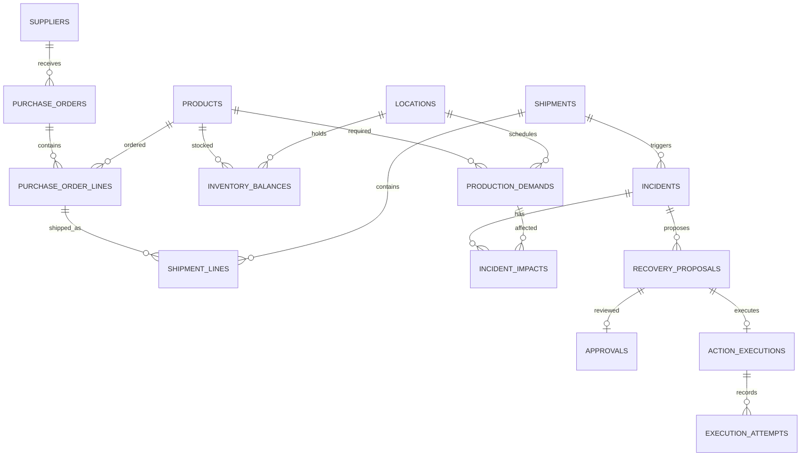

# OpsFlow AI — Database Schema

## 1. Database and Design Conventions

Database: PostgreSQL.
ORM: SQLAlchemy.
Schema migrations: Alembic.

- Use UUID primary keys.
- Use TIMESTAMPTZ for timestamps.
- Use NUMERIC(18, 2) for monetary totals.
- Use NUMERIC(18, 4) for unit prices.
- Use NUMERIC(18, 3) for quantities.
- Use Python Decimal for quantity and money calculations.
- Store currency codes alongside monetary values.
- Express quantities in the product's defined unit of measure.
- Use foreign keys to enforce relationships.
- Validate statuses using explicit CHECK constraints or enums.
- Required fields are NOT NULL unless explicitly optional.
- Record created_at and updated_at on mutable business records.

The MVP supports one manufacturer and one currency per proposal.
Currency conversion is outside the initial scope.

## 2. Identity and Access

### users

- id: UUID, primary key
- email: TEXT, unique, stored in normalized lowercase
- password_hash: TEXT
- role: TEXT — OPERATOR, PROCUREMENT_MANAGER, ADMIN
- is_active: BOOLEAN
- created_at: TIMESTAMPTZ

### sessions

- id: UUID, primary key
- user_id: UUID, foreign key → users.id
- token_hash: TEXT, unique
- expires_at: TIMESTAMPTZ
- revoked_at: TIMESTAMPTZ, nullable
- created_at: TIMESTAMPTZ

Store only the hash of the opaque session token.
Approval permissions are enforced by the backend.

## 3. Operational Data

### products

- id: UUID, primary key
- sku: TEXT, unique
- name: TEXT
- unit_of_measure: TEXT
- is_active: BOOLEAN

### locations

- id: UUID, primary key
- code: TEXT, unique
- name: TEXT
- type: TEXT — PLANT, WAREHOUSE

### inventory_balances

- id: UUID, primary key
- product_id: UUID, foreign key → products.id
- location_id: UUID, foreign key → locations.id
- on_hand_qty: NUMERIC(18, 3)
- reserved_qty: NUMERIC(18, 3)
- observed_at: TIMESTAMPTZ
- source_system: TEXT
- source_version: TEXT

Constraints:
- UNIQUE(product_id, location_id)
- on_hand_qty >= 0
- reserved_qty >= 0
- reserved_qty <= on_hand_qty

These are external inventory snapshots.
The owning WMS must confirm stock reservations and transfers.

### suppliers

- id: UUID, primary key
- code: TEXT, unique
- name: TEXT
- approval_status: TEXT — APPROVED, SUSPENDED, PENDING

### supplier_offers

- id: UUID, primary key
- supplier_id: UUID, foreign key → suppliers.id
- product_id: UUID, foreign key → products.id
- unit_price: NUMERIC(18, 4)
- currency: CHAR(3)
- available_qty: NUMERIC(18, 3)
- lead_time_hours: INTEGER
- observed_at: TIMESTAMPTZ
- valid_until: TIMESTAMPTZ

Constraints:
- unit_price >= 0
- available_qty >= 0
- lead_time_hours >= 0
- valid_until > observed_at

### purchase_orders

- id: UUID, primary key
- source_system: TEXT
- external_id: TEXT
- supplier_id: UUID, foreign key → suppliers.id
- destination_id: UUID, foreign key → locations.id
- status: TEXT — OPEN, CONFIRMED, PARTIALLY_RECEIVED, RECEIVED, CANCELLED
- currency: CHAR(3)
- expected_at: TIMESTAMPTZ

Constraint:
- UNIQUE(source_system, external_id)

### purchase_order_lines

- id: UUID, primary key
- purchase_order_id: UUID, foreign key → purchase_orders.id
- line_number: INTEGER
- product_id: UUID, foreign key → products.id
- quantity: NUMERIC(18, 3)
- unit_price: NUMERIC(18, 4)

Constraints:
- UNIQUE(purchase_order_id, line_number)
- line_number > 0
- quantity > 0
- unit_price >= 0

### shipments

- id: UUID, primary key
- source_system: TEXT
- external_id: TEXT
- destination_id: UUID, foreign key → locations.id
- status: TEXT — PLANNED, IN_TRANSIT, DELAYED, DELIVERED, CANCELLED
- original_eta: TIMESTAMPTZ
- current_eta: TIMESTAMPTZ
- observed_at: TIMESTAMPTZ

Constraint:
- UNIQUE(source_system, external_id)

### shipment_lines

- id: UUID, primary key
- shipment_id: UUID, foreign key → shipments.id
- purchase_order_line_id: UUID, foreign key → purchase_order_lines.id
- quantity: NUMERIC(18, 3)

Constraints:
- UNIQUE(shipment_id, purchase_order_line_id)
- quantity > 0

### production_demands

- id: UUID, primary key
- source_system: TEXT
- source_ref: TEXT
- plant_id: UUID, foreign key → locations.id
- product_id: UUID, foreign key → products.id
- required_qty: NUMERIC(18, 3)
- fulfilled_qty: NUMERIC(18, 3)
- required_at: TIMESTAMPTZ
- status: TEXT — OPEN, PARTIALLY_FULFILLED, FULFILLED, CANCELLED

Constraints:
- UNIQUE(source_system, source_ref)
- required_qty > 0
- fulfilled_qty >= 0
- fulfilled_qty <= required_qty

The application validates that plant_id refers to a PLANT.

## 4. Incidents and Evidence

### incidents

- id: UUID, primary key
- reference: TEXT, unique
- shipment_id: UUID, foreign key → shipments.id
- type: TEXT — SHIPMENT_DELAY
- severity: TEXT — LOW, MEDIUM, HIGH, CRITICAL
- status: TEXT
- assigned_to: UUID, nullable, foreign key → users.id
- version: INTEGER, default 1
- created_at: TIMESTAMPTZ
- updated_at: TIMESTAMPTZ

Incident statuses:
RECEIVED, INVESTIGATING, AWAITING_APPROVAL, EXECUTING,
VERIFYING, RESOLVED, NEEDS_REVIEW, FAILED.

The version field supports optimistic concurrency checks.

### incident_impacts

- id: UUID, primary key
- incident_id: UUID, foreign key → incidents.id
- production_demand_id: UUID, foreign key → production_demands.id
- usable_qty: NUMERIC(18, 3)
- shortage_qty: NUMERIC(18, 3)
- at_risk_at: TIMESTAMPTZ
- calculated_at: TIMESTAMPTZ

Constraints:
- UNIQUE(incident_id, production_demand_id)
- usable_qty >= 0
- shortage_qty >= 0

This table stores the latest calculated impact.
Historical calculation evidence is preserved in incident_evidence.

### incident_evidence

- id: UUID, primary key
- incident_id: UUID, foreign key → incidents.id
- source_system: TEXT
- source_ref: TEXT
- observed_at: TIMESTAMPTZ
- retrieved_at: TIMESTAMPTZ
- payload: JSONB

Evidence records are append-only.
Sensitive credentials must never be included in payloads.

## 5. Recovery and Approval

### recovery_proposals

- id: UUID, primary key
- incident_id: UUID, foreign key → incidents.id
- version: INTEGER
- action_type: TEXT — STOCK_TRANSFER, EXPEDITE_SHIPMENT, CREATE_PO
- payload: JSONB
- payload_hash: TEXT
- estimated_cost: NUMERIC(18, 2)
- currency: CHAR(3)
- estimated_arrival: TIMESTAMPTZ
- decision_summary: TEXT
- status: TEXT — PROPOSED, APPROVED, REJECTED, EXPIRED, SUPERSEDED
- expires_at: TIMESTAMPTZ
- created_at: TIMESTAMPTZ

Constraints:
- UNIQUE(incident_id, version)
- version > 0
- estimated_cost >= 0
- expires_at > created_at

Each option has its own proposal row and incident-scoped version.
The action payload, cost, currency and arrival estimate are immutable.
Changing these fields creates a new proposal requiring new approval.

Payloads are validated against action-specific Pydantic schemas.
Payload hashes use a defined canonical serialization.

### approvals

- id: UUID, primary key
- proposal_id: UUID, unique, foreign key → recovery_proposals.id
- status: TEXT — PENDING, APPROVED, REJECTED, EXPIRED
- requested_at: TIMESTAMPTZ
- decided_by: UUID, nullable, foreign key → users.id
- decided_at: TIMESTAMPTZ, nullable
- reason: TEXT, nullable

APPROVED and REJECTED decisions require decided_by and decided_at.
A decision is final; subsequent changes require a new proposal.

The MVP permits one selected recovery action per incident at a time.
The approval service locks the incident row and verifies that another
proposal has not already been approved or is executing.

## 6. External Execution

### action_executions

- id: UUID, primary key
- proposal_id: UUID, unique, foreign key → recovery_proposals.id
- idempotency_key: TEXT, unique
- status: TEXT — PENDING, RUNNING, UNKNOWN, CONFIRMED, FAILED
- external_reference: TEXT, nullable
- created_at: TIMESTAMPTZ
- updated_at: TIMESTAMPTZ

### execution_attempts

- id: UUID, primary key
- execution_id: UUID, foreign key → action_executions.id
- attempt_number: INTEGER
- request: JSONB
- response: JSONB, nullable
- error_code: TEXT, nullable
- started_at: TIMESTAMPTZ
- finished_at: TIMESTAMPTZ, nullable

Constraints:
- UNIQUE(execution_id, attempt_number)
- attempt_number > 0

All attempts for an execution reuse its idempotency key.
Requests and responses are redacted before storage.

A timeout does not prove that an external action failed.
Unknown outcomes require external reconciliation before resubmission.

CONFIRMED means the external system accepted the action.
It does not mean transferred stock has arrived.

## 7. Events, Jobs and Audit

### integration_events

- id: UUID, primary key
- source_system: TEXT
- source_event_id: TEXT
- incident_id: UUID, nullable, foreign key → incidents.id
- payload: JSONB
- received_at: TIMESTAMPTZ
- processed_at: TIMESTAMPTZ, nullable

Constraint:
- UNIQUE(source_system, source_event_id)

### jobs

- id: UUID, primary key
- incident_id: UUID, foreign key → incidents.id
- deduplication_key: TEXT, unique
- job_type: TEXT — INVESTIGATE, RESUME, EXECUTE, RECONCILE
- payload: JSONB
- status: TEXT — PENDING, RUNNING, COMPLETED, FAILED
- attempts: INTEGER, default 0
- run_after: TIMESTAMPTZ
- lease_until: TIMESTAMPTZ, nullable
- worker_id: TEXT, nullable
- lease_token: UUID, nullable
- last_error: TEXT, nullable
- created_at: TIMESTAMPTZ

Constraint:
- attempts >= 0

Workers claim jobs transactionally.
Lease ownership is checked when updating job state.
Expired leases allow recovery after worker crashes.
External idempotency protects against repeated business effects.

### audit_events

- id: UUID, primary key
- incident_id: UUID, nullable, foreign key → incidents.id
- actor_type: TEXT — USER, WORKER, SYSTEM
- actor_id: TEXT
- event_type: TEXT
- decision_summary: TEXT
- metadata: JSONB
- created_at: TIMESTAMPTZ

Audit events are append-only.
Application database permissions and mutation-blocking triggers
prevent ordinary application UPDATE and DELETE operations.

Record evidence, actions, approvals and concise decision summaries.
Do not store hidden model reasoning or credentials.

These controls alone do not establish regulatory compliance or
protect against every privileged database administrator action.

LangGraph checkpoint tables are managed separately by its
PostgreSQL checkpointer.

## 8. Core Relationships

## 9. Initial Indexes

In addition to primary-key and unique indexes:

- incidents(status, created_at)
- incidents(shipment_id)
- production_demands(plant_id, product_id, required_at)
- incident_evidence(incident_id, retrieved_at)
- audit_events(incident_id, created_at)
- approvals(status, requested_at)
- jobs(status, run_after)
- jobs(status, lease_until)
- sessions(user_id)

Additional indexes will follow actual query patterns and measurements.

## 10. Integrity and Transaction Rules

- Restrict deletion of records referenced by business history.
- Create an incoming event, incident and initial job atomically
  when accepting a new disruption.
- Persist an approval decision and its resume job atomically.
- Validate incident state transitions in business services.
- Recheck approval validity and external conditions before execution.
- Never assume a local transaction can roll back an external action.
- Enforce cross-table rules in transactional services where simple
  database constraints cannot express them.

## 11. First Acceptance Scenario

- Munich demand: 500 units due in 8 hours.
- Munich on-hand stock: 120 units.
- Munich reserved stock: 0 units.
- Delayed inbound stock: 500 units arriving in 3 days.
- Berlin transferable stock: 380 units.
- Transfer time: 6 hours.
- Transfer freight: USD 2,400.

Expected shortage: 380 units.
Expected recovery proposal: transfer 380 units from Berlin.

For this first scenario, there is one open demand and no competing
reservations. When multiple demands are introduced, stock must be
allocated in a defined order so the same units are not counted twice.

Approval and transfer-order confirmation do not prove receipt.
Resolution requires verification against the recovery condition.